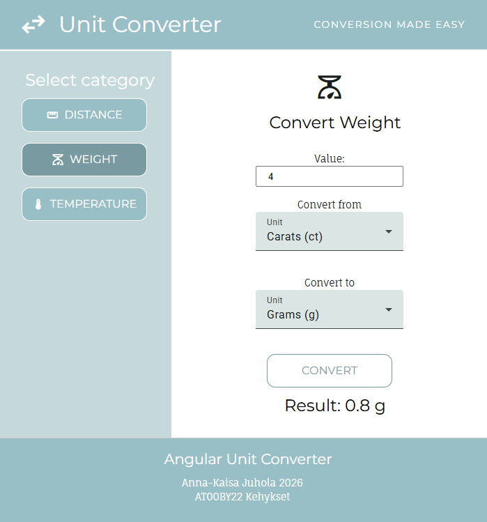

# Unit converter

Course: **AT00BY22 Kehykset**  
Author: **Kaisa Juhola**  
Updated: **22.11.2026**

## About project

This project is a unit converter application developed using Angular and TypeScript. It allows users to convert values between different units in three categories: distance, weight, and temperature. The application features a simple and user-friendly interface, with dynamically populated category and unit selectors. The main goal was to learn Angular and practise building a component-based, reactive web application.

### Project file structure

```bash
src/app/
│
├── components/
│   ├── header/
│   ├── category-selector/
│   ├── unit-selector/
│   └── converter/
│
├── pages/
│   ├── home/ (not implemented)
│   └── about/ (not implemented)
│
├── services/
│   └── conversion.ts
│
├── models/
│   └── converter.model.ts
│
├── data/
│   └── conversion-data.ts
│
├── app.ts
├── app.html
└── app.routes.ts
```

## Installation and environmental setup

This project was generated using [Angular CLI](https://github.com/angular/angular-cli) version 22.2.4. It uses Angular Material for UI components and Angular Signals for reactive state management.

### Requirements

- Node.js
- npm (included with Node.js)
- Angular CLI

### Installation

Install the dependencies:

```bash
npm install
```

If Angular CLI is not installed, install it globally:

```bash
npm install -g @angular/cli
```

### Start

To start a local development server, run:

```bash
ng serve
```

Once the server is running, open your browser and navigate to `http://localhost:4200/`. The application will automatically reload whenever you modify any of the source files. The application runs locally in the browser. No backend or database is required.

## Running unit tests

To execute unit tests with the [Vitest](https://vitest.dev/) test runner, use the following command:

```bash
ng test
```

## Requirements and Grading

I am aiming for a grade 4. All other requirements are met except routing.

### Grade 1

- The applicatin uses components in the implementation
  - [category-selector](/src/app/components/category-selector/)
  - [converter](/src/app/components/converter/)
  - [footer](/src/app/components/footer/)
  - [header](/src/app/components/header/)
  - [unit-selector](/src/app/components/unit-selector/)
- The application installation process works as documented above
- The application starts up

### Grade 3

- Three conversion categories and at least six converters
  - Distance (10 units, with conversions implemented between all of them)
  - Weight (7 units, with conversions implemented between all of them)
  - Temperature (3 units, with conversions implemented between all of them)
- Icon displays the currently selected conversion category and the icon is updated automatically when category is changed (see pictures below)
- Angular [service](/src/app/services/) is used to implement the conversion operations
- Angular material library is used in the UI implementation
  - MatButtonModule
  - MatIconModule
  - MatSelectModule
  - MatFormFieldModule

### Grade 5

- Routing (not implemented)
- Converter category and converter selectors are populated programmatically
  - [category-selector](src/app/components/category-selector/category-selector.html)
    - Instead of writing out the three categories separately, we iterate through the list returned by the `categories()` function using a for-loop.
      The `category.id` indicates that each category button has its own unique ID, which is used for tracking.
    - In [converter.ts](src/app/components/converter/converter.ts) `categories = CONVERSION_CATEGORIES` that uses [data/conversion-data](/UnitConverter/src/app/data/conversion-data.ts)
    - If a new category is added to the data later, it will appear in the selection list without any HTML changes.
  - [unit-selector](src/app/components/category-selector/category-selector.html)
    - Unit selector (converter selector) is implemented using the same logic as category selector
  - [converter.html](src/app/components/converter/converter.html)
- Reactive programming is used in the application through signals
  - Signals manage the selected category, selected units, and input value in the [converter](src/app/components/converter/converter.ts) component
  - When a signal's value changes, Angular automatically updates the parts of the UI that depend on it. This keeps the UI synchronized with the application state without requiring manual updates.
    - When the user selects a different category, the `selectedCategory` signal is updated, and the available units change automatically.
    - When the user selects a different input or output unit, the corresponding signal is updated.
    - When the user enters a new value, the `inputValue` signal is updated.

## Screenshot



## Application components and their responsibilities

### Category selector

Displays the available conversion categories (distance, weight, and temperature). Allows the user to select which type of units they want to convert.

### Unit selector

Provides dropdown menus for selecting the source and target units. The available options are populated dynamically based on the selected category.

### Converter

The main component that handles the conversion functionality. It manages the selected category, input value, source and target units, and displays the conversion result.

### Header

Displays the application icon/logo, name and slogan. (Possibility to add navigation links if the routing feature is implemented later.)

### Footer

Displays additional information about the application.

## Features not implemented

- Routing

## Extra features

- Unit tests
  - [category-selector.spec.ts](/src/app/components/category-selector/category-selector.spec.ts)
  - [unit-selector.spec.ts](/src/app/components/unit-selector/unit-selector.spec.ts)
  - [conversion.spec.ts](/src/app/services/conversion.spec.ts)

## Use of AI

### How AI was used

AI (ChatGPT) was used as a supporting tool during the development of the application. It helped with understanding Angular concepts, solving programming problems, and improving the code.

Examples of AI assistance:

- Explaining Angular Signals and reactive programming
- Providing guidance on component structure and communication between components
- Helping implement unit conversion logic (For example I made separate conversion functions such as `metersToMails()` first, but then asked the AI ​​to suggest a more efficient way to implement the conversions. )
- Helping to understand how Angular service works
- Troubleshooting errors
- Reviewing code and suggesting improvements

VSCode Copilot inline suggestions were also used.

### Motivation

The main reason for using AI was to support learning Angular, which was a relatively new framework to me even though I have worked quite a bit with React. AI provided explanations and practical examples that helped me understand unfamiliar concepts and solve problems more efficiently.

### What I Learned

Using AI helped me learn more about Angular components, signals, services, dependency injection, and reactive programming. I also gained a better understanding how to structure an Angular application.

However, AI did not replace the need to understand the code myself. I still had to review suggestions, test the solutions, identify errors, and make implementation decisions. I learned that AI can sometimes provide solutions that need correction or adaptation to the project.

Overall, AI supported my learning process, but the practical implementation and understanding of the application came through my own work and testing.

AI-generated suggestions were reviewed, tested, and adapted to the project. The implementation decisions and final code were made and verified by the developer.
